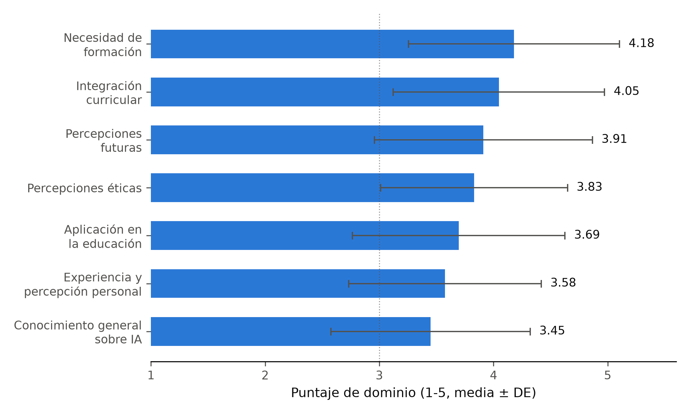
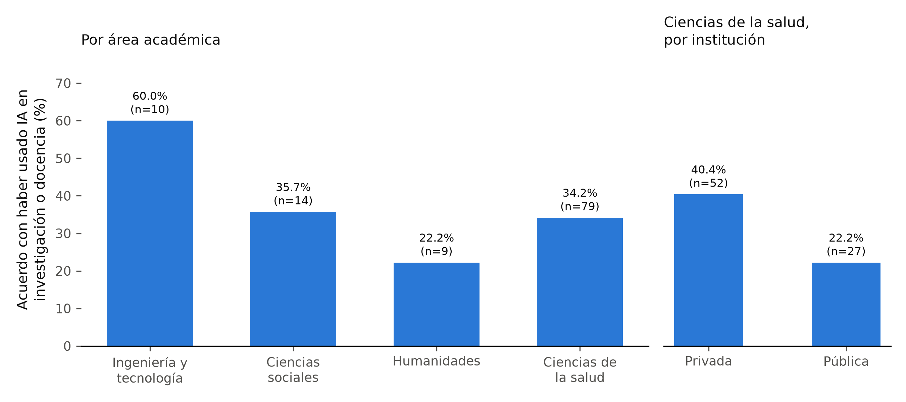

**Andrea Paola Britos Gómez¹ (ORCID: 0009-0000-8655-9881), Alcides Chaux¹\* (ORCID: 0000-0002-5824-9867)**

¹ChauxLab Institute, Asunción, Paraguay

\*Autor de correspondencia: Alcides Chaux — alcides.chaux@chauxlab.com

# RESUMEN

**Antecedentes:** Los docentes universitarios darán forma al uso y la enseñanza de la inteligencia artificial (IA) en la educación superior. Su conocimiento autopercibido, sus preocupaciones éticas y su experiencia con estas herramientas no se han descrito en Paraguay.

**Objetivo:** Describir, en una muestra de conveniencia de docentes universitarios de Paraguay, el conocimiento autopercibido, las preocupaciones éticas, las necesidades de formación y el acuerdo con haber usado IA.

**Métodos:** Encuesta transversal, exploratoria, en línea, entre diciembre de 2023 y enero de 2024, con un cuestionario Likert de 25 ítems elaborado para el estudio. El archivo de respuestas contenía 667 filas, pero solo 113 respuestas distintas; el análisis se restringió a ellas. Los puntajes de dominio son índices exploratorios (promedios no ponderados); las proporciones se informan con intervalos de confianza de Wilson.

**Resultados:** Respondieron 113 docentes: 69,9 % de ciencias de la salud, 73,5 % de sexo femenino y 72,6 % de instituciones privadas; la edad media fue de 45,6 años (DE 10,4). El acuerdo con comprender los principios básicos de la IA fue del 66,4 % (IC 95 % 57,3-74,4) y con poder explicar su influencia en la disciplina propia, del 48,7 % (39,7-57,8). El 83,2 % (75,2-89,0) acordó que deben considerarse las implicancias éticas y el 91,2 % (84,5-95,1) quiso comprender mejor esos aspectos. El acuerdo con el ítem «He utilizado IA en mi investigación o enseñanza» fue del 35,4 % (27,2-44,6); las diferencias por área académica o tipo de institución fueron imprecisas y no concluyentes.

**Conclusiones:** En esta muestra, pequeña y no representativa de los docentes de Paraguay, la preocupación ética y la demanda de formación fueron muy frecuentes, y el acuerdo con haber usado IA fue minoritario. Los resultados reflejan percepciones autoinformadas de fines de 2023 y comienzos de 2024, no conocimiento evaluado ni estimaciones poblacionales.

**Palabras clave:** inteligencia artificial; bioética; educación superior; docentes universitarios; desarrollo docente; Paraguay

# INTRODUCCIÓN

La inteligencia artificial entra en la educación superior con suficiente rapidez para exigir al profesorado decidir cómo enseñarla y enseñar con ella antes de que exista un cuerpo de práctica acordado. Un estudio en una institución pública de California halló que el 91,1 % del profesorado encuestado informó haber usado IA generativa, mientras que la formación formal era poco frecuente en el conjunto de participantes [1]. Las perspectivas del profesorado no son un simple sustituto de las del estudiantado: docentes de odontología en India, y de enfermería en EE. UU., informan apoyo a la integración junto con preocupaciones de formación, ética y carga de trabajo propias de enseñar [2,3]. En docentes universitarios de 42 universidades de China, la autoeficacia se asoció con la disposición a adoptar la IA generativa en el aula [4].

La preocupación ética es un hallazgo recurrente. Una guía estructurada para docentes de medicina identifica la transparencia, el sesgo, la protección de datos y la rendición de cuentas como asuntos que el profesorado debe manejar, no solo conocer [5], y una evaluación de necesidades en estudiantes de medicina pide una reestructuración curricular en torno a esas preocupaciones [6]. La preocupación ética sobre la inteligencia artificial en enfermería es casi universal incluso donde el conocimiento es limitado [7], y docentes de anatomía que sopesan promesas y riesgos llegan a una conclusión comparable [8]. Las encuestas de conocimiento-actitud-práctica en estudiantes de medicina y otros profesionales de la salud describen un patrón consistente: actitudes favorables, conocimiento limitado y demanda alta de formación, incluida la ética [9-14]; una revisión de enfermería agrega que la ansiedad y la autoeficacia moderan esa disposición [15], y un estudio de validación de un instrumento de aceptación de tecnología en estudiantes informa la misma tensión entre actitud favorable y uso modesto [16].

La mayor parte de esta evidencia describe a estudiantes o profesionales de la salud distintos del profesorado que los forma, y proviene de profesiones aisladas [2,3,9-14]. Los docentes universitarios como grupo —de distintas áreas académicas, no de una sola profesión de la salud— y en América Latina están menos representados, y no se identificó una descripción comparable para docentes en Paraguay.

# OBJETIVO

Describir, en una muestra de conveniencia de docentes universitarios de Paraguay, el conocimiento autopercibido, las preocupaciones éticas, las necesidades de formación, el apoyo curricular y el acuerdo con haber usado inteligencia artificial, y explorar la asociación del conocimiento autopercibido con la edad y la experiencia docente, su contraste entre docentes de ingeniería y tecnología y de las demás áreas, y la variación del acuerdo con haber usado IA según área académica y, dentro de ciencias de la salud, según tipo de institución.

# MÉTODO

Se trató de una encuesta cuantitativa, exploratoria y transversal a docentes universitarios en ejercicio de instituciones de educación superior públicas y privadas de Paraguay. El reclutamiento fue por conveniencia, a través de canales institucionales, entre diciembre de 2023 y enero de 2024. Este informe sigue, en lo aplicable, las recomendaciones STROBE para estudios transversales [17]. Como el reclutamiento usó canales institucionales y no un listado de docentes invitados individualmente, no se dispuso de marco muestral ni de un denominador de elegibles, y no se registró cuántas personas abrieron o iniciaron el formulario sin completarlo; por ello no puede informarse el flujo de participantes ni una tasa de respuesta.

El cuestionario se construyó para este estudio (el cuestionario completo, con las opciones de respuesta, se presenta en el Anexo). Preguntaba por área académica, años de docencia, edad, sexo y tipo de institución, seguido de 25 enunciados Likert en siete dominios, y cerraba con un único ítem abierto y opcional. Cada enunciado usó una escala de cinco puntos de «totalmente en desacuerdo» a «totalmente de acuerdo». Cinco revisores con experiencia en IA, bioética o educación superior comentaron su claridad y pertinencia, y se piloteó con 25 docentes antes del trabajo de campo; esas respuestas se usaron solo para depurar la redacción y no forman parte de la muestra analítica. El cuestionario se administró en línea, con una página de apertura que describía el estudio y un tiempo esperado de 5 a 10 minutos; la participación fue voluntaria y se solicitaba consentimiento antes de mostrar los ítems.

El ítem sobre experiencia con IA decía literalmente: «He utilizado IA en mi investigación o enseñanza». Combina investigación y docencia, no fija un periodo de recuerdo ni define qué herramientas cuentan como IA (generativa, analítica u otras). Por ello se informa como acuerdo autoinformado con un ítem compuesto, no como medida de frecuencia, de adopción real ni de uso en cada actividad por separado, y las respuestas neutrales no permiten inferir uso o no uso.

**Datos analizados.** El archivo de respuestas conservado por los autores contenía 667 filas con identificadores consecutivos (ID-001 a ID-667), pero solo 113 respuestas distintas: las filas ID-114 a ID-667 reproducían exactamente, en bloques consecutivos, la demografía, los 25 ítems y el comentario de filas anteriores. La exportación original del formulario ya no está disponible, de modo que no pudo verificarse el origen de esas repeticiones. Por ello, el análisis se restringió a las 113 respuestas distintas (ID-001 a ID-113), el único conjunto cuya independencia puede sostenerse, y todos los resultados describen a esas 113 personas. La tesis de maestría que originó el proyecto informó un tamaño muestral distinto (n = 414), que no pudo reconciliarse con la base conservada; el presente análisis se limita a lo que esa base permite sostener.

**Análisis.** Las respuestas se codificaron de 1 a 5 en el sentido administrado, sin ítems invertidos. Un puntaje de dominio fue el promedio no ponderado de sus ítems y se presenta como índice exploratorio de respuestas, no como medida validada de competencias. El acuerdo con un ítem fue la suma de «de acuerdo» y «totalmente de acuerdo», con intervalos de confianza del 95 % de Wilson. La consistencia interna de cada dominio se estimó con el alfa de Cronbach en la muestra analítica; esta estimación describe a estas respuestas, no constituye una validación psicométrica independiente del instrumento, no se realizó análisis factorial y no debe leerse como evidencia de unidimensionalidad. Los ítems 13 («Tengo reservas sobre la dependencia de la IA en la evaluación académica») y 20 (experiencia con IA) conviven en dominios con ítems actitudinales de sentido distinto, por lo que se informan también por separado. La edad y los años de docencia se resumieron con la media, la desviación estándar, la mediana y el rango, y su asociación entre sí y con el puntaje de conocimiento se estimó con coeficientes de Spearman. El contraste del puntaje de conocimiento entre docentes de ingeniería y tecnología y los de todas las demás áreas se hizo con la prueba de Mann-Whitney a dos colas como análisis principal, porque los puntajes son ordinales y las varianzas difieren entre grupos (el protocolo contemplaba pruebas t o ANOVA «según corresponda»), con la t de Welch como análisis de sensibilidad, y se informan la diferencia de medias con su intervalo de confianza, la d de Cohen y el delta de Cliff con intervalos por remuestreo. El acuerdo con haber usado IA se describió en general, por área académica y, entre ciencias de la salud, por tipo de institución, con la prueba exacta de Fisher y un odds ratio ajustado por sexo, edad y años de docencia como análisis complementario. Estos análisis son exploratorios, sin ajuste por comparaciones múltiples. Las respuestas abiertas eran opcionales, se leyeron en su totalidad para verificar contenido identificatorio y no se analizaron, por no haberse planificado un análisis cualitativo. Los análisis se ejecutaron en Python 3.

## Consideraciones éticas

El protocolo se presentó como proyecto de tesis de un programa de maestría (Universidad Europea del Atlántico) a través de la plataforma del programa, que autorizó el paso a la fase siguiente; el programa no exigió un dictamen de comité de ética para este estudio, porque el cuestionario era anónimo y no recolectaba datos personales. En consecuencia, no se emitió una aprobación ni una exención formal de un comité, ni se asignó un número, y no se dispone de constancia escrita de autorización de las instituciones participantes. El formulario exigía consentimiento activo antes de mostrar los ítems y no solicitaba nombre, datos de contacto ni institución empleadora. Los identificadores del archivo (ID-001 en adelante) fueron asignados por los autores al preparar la base; el comentario libre no se comparte. No se evaluó formalmente el riesgo de reidentificación en categorías pequeñas (por ejemplo, la única persona de ciencias agrícolas).

# RESULTADOS

Se analizaron 113 respuestas distintas, todas con los 25 ítems completos. Ciencias de la salud representó 79 respondientes (69,9 %), ciencias sociales 14 (12,4 %), ingeniería y tecnología 10 (8,8 %), humanidades 9 (8,0 %) y ciencias agrícolas 1 (0,9 %). Por sexo, 83 (73,5 %) fueron de sexo femenino y 30 (26,5 %) de sexo masculino. Las instituciones privadas aportaron 82 respondientes (72,6 %) y las públicas 31 (27,4 %); el 87,1 % (27/31) de los docentes de instituciones públicas pertenecía a ciencias de la salud. La edad varió de 27 a 76 años (media 45,6, DE 10,4; mediana 45) y los años de docencia de 1 a 41 (media 14,9, DE 9,6; mediana 14). La edad y la experiencia docente se asociaron positivamente (ρ de Spearman = 0,77).

**Tabla 1. Características de los 113 respondientes**

| Característica | Valor |
| --- | --- |
| Área académica, n (%) | |
| Ciencias de la salud | 79 (69,9) |
| Ciencias sociales | 14 (12,4) |
| Ingeniería y tecnología | 10 (8,8) |
| Humanidades | 9 (8,0) |
| Ciencias agrícolas | 1 (0,9) |
| Sexo, n (%) | |
| Femenino | 83 (73,5) |
| Masculino | 30 (26,5) |
| Institución, n (%) | |
| Privada | 82 (72,6) |
| Pública | 31 (27,4) |
| Edad, años, media (DE) | 45,6 (10,4) |
| Experiencia docente, años, media (DE) | 14,9 (9,6) |

El conocimiento autopercibido se ubicó en la mitad de la escala (media de dominio 3,45, DE 0,87; α de Cronbach = 0,91). El acuerdo por ítem varió del 48,7 % (poder explicar su influencia en la disciplina propia) al 66,4 % (comprender los principios básicos) (Tabla S1). Los puntajes de conocimiento no se asociaron con los años de docencia (ρ de Spearman = 0,03) ni con la edad (ρ = 0,04). Los docentes de ingeniería y tecnología (n = 10) tuvieron una media de conocimiento de 3,78 (DE 1,20) y los de las demás áreas combinadas (n = 103), de 3,42 (DE 0,84): diferencia de 0,36 (IC 95 % −0,51 a 1,22; t de Welch, P = 0,38; Mann-Whitney, P = 0,17), d de Cohen = 0,41 (IC −0,47 a 1,26) y delta de Cliff = 0,26 (IC −0,17 a 0,67). La diferencia no es concluyente: el intervalo incluye valores nulos y valores grandes, y el grupo es de solo 10 personas.

La preocupación ética fue alta (media de dominio 3,83, DE 0,82; α = 0,90), con un acuerdo por ítem de 59,3 % a 83,2 % (Tabla S1); el más alto fue que las implicancias éticas deben considerarse en el desarrollo y uso de la IA (83,2 %, IC 75,2-89,0).

Las actitudes hacia el uso en educación fueron favorables en su conjunto (media de dominio 3,69, DE 0,93; α = 0,88). El acuerdo con los tres ítems favorables varió del 65,5 % al 71,7 % (Tabla S1; α de los tres ítems = 0,92). Las reservas sobre depender de la IA en la evaluación académica (ítem 13) fueron respaldadas por el 51,3 % (IC 42,2-60,3) y correlacionaron positivamente con los tres ítems favorables (r de Pearson de 0,42 a 0,48), de modo que el promedio de este dominio no es interpretable como un puntaje actitudinal unidimensional.

La demanda de formación fue el puntaje de dominio más alto (media 4,18, DE 0,92; α = 0,93). El acuerdo por ítem fue del 80,5 % (más contenido sobre bioética de la IA en los programas académicos) al 91,2 % (comprender mejor los aspectos éticos; IC 84,5-95,1) (Tabla S1). El apoyo a la integración curricular también fue alto (media de dominio 4,05, DE 0,93; α = 0,90), con un acuerdo del 69,9 % con incluir IA y bioética en el currículo y del 82,3 % con mayor exposición de los estudiantes a las cuestiones éticas.

El acuerdo con haber usado inteligencia artificial en investigación o docencia fue del 35,4 % (40/113; IC 27,2-44,6); el desacuerdo, del 36,3 % (41/113) y las respuestas neutrales, del 28,3 % (32/113). Al mismo tiempo, el 77,9 % acordó que la IA cambiará significativamente la docencia en los próximos años y el 85,8 % que mantenerse al día con los desarrollos emergentes importa para su desarrollo profesional. Por área, el acuerdo fue del 60,0 % (6/10; IC 31,3-83,2) en ingeniería y tecnología, del 35,7 % (5/14; IC 16,3-61,2) en ciencias sociales, del 34,2 % (27/79; IC 24,7-45,2) en ciencias de la salud y del 22,2 % (2/9; IC 6,3-54,7) en humanidades (Figura 2); ciencias agrícolas (n = 1) no se incluye. Dentro de ciencias de la salud, fue del 40,4 % (21/52; IC 28,2-53,9) en instituciones privadas y del 22,2 % (6/27; IC 10,6-40,8) en públicas: diferencia de 18,2 puntos porcentuales (IC 95 % −2,4 a 38,7; Fisher, P = 0,14; odds ratio ajustado por sexo, edad y años de docencia 2,39, IC 0,75-7,58). Los intervalos son amplios y la diferencia no es concluyente.

**Tabla 2. Puntajes de dominio en la muestra analítica (n = 113)**

| Dominio | Ítems | α de Cronbach | Media (DE) |
| --- | ---: | ---: | --- |
| Conocimiento general sobre inteligencia artificial | 4 | 0,91 | 3,45 (0,87) |
| Percepciones éticas | 5 | 0,90 | 3,83 (0,82) |
| Aplicación en la educación | 4 | 0,88 | 3,69 (0,93) |
| Necesidades de formación en inteligencia artificial y bioética | 3 | 0,93 | 4,18 (0,92) |
| Integración curricular | 3 | 0,90 | 4,05 (0,93) |
| Experiencia y percepción personal | 4 | 0,79 | 3,58 (0,84) |
| Percepciones futuras y tendencias | 2 | 0,84 | 3,91 (0,95) |

Los puntajes son promedios no ponderados de ítems codificados de 1 a 5 e índices exploratorios. El alfa se estimó en esta muestra. «Aplicación en la educación» incluye un ítem de reserva (ítem 13) y «Experiencia y percepción personal», el ítem de experiencia con IA (ítem 20) junto a ítems actitudinales; ambos se informan también por separado en el texto. Las medias, desviaciones estándar y porcentajes de acuerdo con intervalos de confianza para los 25 enunciados están en la Tabla S1.

**Figura 1. Puntajes de dominio en la muestra analítica (n = 113), media ± DE**

Los mismos siete puntajes de la Tabla 2, ordenados de mayor a menor. La línea punteada marca el punto medio de la escala (3 = «neutral»).

**Figura 2. Acuerdo con haber usado inteligencia artificial en investigación o docencia, por área académica e institución**

Panel izquierdo: porcentaje de acuerdo con el ítem 20, por área académica (se excluye ciencias agrícolas, n = 1). Panel derecho: el mismo ítem dentro de ciencias de la salud, por tipo de institución. Los grupos son pequeños y los intervalos de confianza, amplios (ver texto).

# DISCUSIÓN

En esta muestra de 113 docentes universitarios de Paraguay, la preocupación ética y la demanda de formación fueron altas, mientras que el conocimiento autopercibido fue intermedio y el acuerdo con haber usado IA siguió siendo minoritario (35,4 %; 28,3 % de respuestas neutrales, que no permiten inferir uso o no uso). El patrón es paralelo al de encuestas de conocimiento-actitud-práctica en profesionales de salud de Siria, Pakistán, la región árabe y Sudán [10-13], y al de un estudio de validación de un instrumento de aceptación de tecnología en estudiantes de Jordania, con utilidad percibida y baja exposición previa [16]. El acuerdo con haber usado IA fue menor que el 91,1 % informado por el profesorado de una institución californiana [1], aunque con constructos, instrumentos, muestreo y momento distintos, y no directamente comparable; se acerca a una revisión de enfermería con actitudes positivas y limitaciones de infraestructura [15].

Una explicación posible, que esta encuesta no puede evaluar, es que la percepción de la utilidad y de lo éticamente relevante de la IA se haya adelantado a la percepción de la propia capacidad para usarla; las revisiones y modelos de adopción señalan el papel de la autoeficacia y de las expectativas de resultado [4,15]. Debe tratarse como una hipótesis para estudios con diseño y muestras adecuados, no como un hallazgo.

La diferencia de conocimiento entre ingeniería y tecnología y las demás áreas no fue concluyente, con un grupo de 10 personas y un intervalo que incluye tanto la ausencia de diferencia como diferencias grandes; tampoco hubo asociación con los años de docencia ni con la edad. Estudios en odontología, enfermería y fisioterapia informan que la disciplina y la experiencia moldean las percepciones, aunque no siempre el conocimiento [2,3,18]. El acuerdo con haber usado IA fue mayor en instituciones privadas que en públicas dentro de ciencias de la salud (40,4 % frente a 22,2 %), pero la diferencia es imprecisa (IC de la diferencia −2,4 a 38,7). Un patrón de ese sentido sería compatible con un estudio de 1114 docentes de universidades públicas y privadas de América Latina, que halló mayor valoración, frecuencia de uso y competencia digital autopercibida de las tecnologías de la información y la comunicación (no de IA) en el sector privado [19], y con un estudio de caso de una institución latinoamericana que atribuyó diferencias similares a la infraestructura institucional [20], pero esta muestra no permite sostener esa conclusión. La comparación tampoco puede separarse por completo de la composición de la muestra: el 87,1 % de los docentes públicos pertenece a ciencias de la salud.

La demanda de contenido ético en el currículo (80,5 % pidió más contenido sobre bioética de la IA en los programas) coincide con un consenso más amplio —el uso ético requiere guía estructurada, no exposición incidental [5,6,8]— y con la Recomendación de la UNESCO sobre la Ética de la IA [21] y su marco de competencias en IA para docentes [22]. Si las instituciones acompañan esa orientación es una pregunta de política educativa que esta encuesta no responde. Las reservas sobre depender de la IA en la evaluación correlacionaron en positivo con las actitudes favorables, coherente con apoyo y cautela ética coexistiendo, como en enfermería [7].

Este estudio tiene limitaciones propias de su evidencia. La muestra es pequeña (113), de conveniencia, sin marco muestral ni flujo de participantes, y concentrada en ciencias de la salud (69,9 %) e instituciones privadas (72,6 %); es probable la autoselección de docentes interesados en la IA, que puede inflar la preocupación ética y la demanda de formación. No se comparó su composición con datos poblacionales del profesorado paraguayo, que no se tuvo a disposición. Los resultados se refieren a estas 113 personas y no a los docentes de Paraguay. El archivo original contenía filas repetidas cuyo origen no pudo verificarse (Método), por lo que se analizaron solo las respuestas distintas. El cuestionario no fue validado de forma independiente y sus dominios mezclan ítems de distinto sentido. Los comentarios libres no se analizaron. La recolección (diciembre de 2023-enero de 2024) fue poco más de un año después del lanzamiento de las herramientas de IA generativa (noviembre de 2022) y antes de su adopción masiva posterior; estudios de 2025-2026 ya describen mayor adopción [1,4], por lo que estos resultados describen un momento temprano y no la situación actual. El diseño transversal y autoinformado no sostiene afirmaciones causales.

# CONCLUSIONES

En esta muestra pequeña y de conveniencia de docentes universitarios de Paraguay, la preocupación ética y la demanda de formación en IA fueron muy frecuentes, el conocimiento autopercibido fue intermedio y el acuerdo con haber usado IA fue minoritario, con diferencias entre áreas e instituciones imprecisas y no concluyentes. Estas percepciones, registradas a fines de 2023 y comienzos de 2024, ofrecen una línea de base descriptiva que un instrumento validado y un muestreo probabilístico podrían poner a prueba.

# ACLARACIONES

Autoría: conceptualización, A.C.; metodología, A.C.; curación de datos, A.C.; redacción del borrador original, A.C.; redacción, revisión crítica y edición, A.C. y A.P.B.G.; supervisión, A.C. Ambos autores leyeron y aprobaron la versión final del manuscrito.

Agradecimientos: No aplica.

Presentaciones previas: Un avance de una versión previa de este trabajo se presentó como comunicación oral en el X Encuentro de Investigadores (EDIN), Sociedad Científica del Paraguay, Asunción, Paraguay, 4 al 7 de noviembre de 2025.

Manuscritos en servidores de preprints y repositorios: Este manuscrito no se encuentra en ningún servidor de preprints. El protocolo, el archivo de las 113 respuestas distintas (sin comentarios libres), el código de análisis y las referencias en formato RIS se depositarán en un repositorio de acceso abierto.

Financiamiento: Esta investigación no recibió financiamiento externo.

Conflicto de interés: Los autores declaran no tener conflictos de interés.

Declaración de IA y tecnologías asistidas por IA en el proceso de escritura: Los autores reconocen el uso de herramientas de inteligencia artificial (Claude, Anthropic, a través de Claude Code) para la búsqueda y verificación de literatura científica (PubMed), el reanálisis de los datos, la generación de las Figuras 1 y 2 mediante un script de análisis ejecutado sobre los datos, la redacción y traducción del texto y la gestión del repositorio de material suplementario. Los autores revisaron, verificaron y asumen completa responsabilidad intelectual por el contenido, la metodología, los resultados y las conclusiones de este manuscrito, incluida la exactitud de cada cifra frente a los datos fuente y de cada referencia bibliográfica citada.

# REFERENCIAS

1. Oleribe OO, Sabado P, Begum KT, Mutchler MG, Piccoli B, Taylor-Robinson AW, et al. Generative artificial intelligence adoption and use in teaching and training healthcare professionals in higher education in the United States: a cross-sectional study. BMC Med Educ. 2026;26(1). doi:10.1186/s12909-026-09291-8
2. Chutia J, Rupali R, Jain M, Angel A, Agarwal P, Sawhney C. Faculty perspectives on integrating artificial intelligence into orthodontic and interdisciplinary dental education: opportunities, challenges, and strategies. Cureus. 2025;17(9):e92877. doi:10.7759/cureus.92877
3. Blomquist J, Alderden J, Llewellyn S, Haynes M, Dworak E. Student and faculty perceptions and use of generative artificial intelligence in nursing education. J Nurs Educ. 2025;64(8):519-522. doi:10.3928/01484834-20250312-06
4. Xiang Y, Yang C, Jin Z, Zhao W. Factors influencing the adoption of generative artificial intelligence into classroom teaching by university teachers: an empirical study using SPSS PROCESS macros. PLoS One. 2025;20(8):e0324875. doi:10.1371/journal.pone.0324875
5. Franco D'Souza R, Mathew M, Mishra V, Surapaneni KM. Twelve tips for addressing ethical concerns in the implementation of artificial intelligence in medical education. Med Educ Online. 2024;29(1):2330250. doi:10.1080/10872981.2024.2330250
6. Civaner MM, Uncu Y, Bulut F, Chalil EG, Tatli A. Artificial intelligence in medical education: a cross-sectional needs assessment. BMC Med Educ. 2022;22(1):772. doi:10.1186/s12909-022-03852-3
7. Wang X, Fei F, Wei J, Huang M, Xiang F, Tu J, et al. Knowledge and attitudes toward artificial intelligence in nursing among various categories of professionals in China: a cross-sectional study. Front Public Health. 2024;12:1433252. doi:10.3389/fpubh.2024.1433252
8. Lazarus MD, Truong M, Douglas P, Selwyn N. Artificial intelligence and clinical anatomical education: promises and perils. Anat Sci Educ. 2024;17(2):249-262. doi:10.1002/ase.2221
9. Jackson P, Ponath Sukumaran G, Babu C, Tony MC, Jack DS, Reshma VR, et al. Artificial intelligence in medical education - perception among medical students. BMC Med Educ. 2024;24(1):804. doi:10.1186/s12909-024-05760-0
10. Swed S, Alibrahim H, Elkalagi NKH, Nasif MN, Rais MA, Nashwan AJ, et al. Knowledge, attitude, and practice of artificial intelligence among doctors and medical students in Syria: a cross-sectional online survey. Front Artif Intell. 2022;5:1011524. doi:10.3389/frai.2022.1011524
11. Ahmed Z, Bhinder KK, Tariq A, Tahir MJ, Mehmood Q, Tabassum MS, et al. Knowledge, attitude, and practice of artificial intelligence among doctors and medical students in Pakistan: a cross-sectional online survey. Ann Med Surg (Lond). 2022;76:103493. doi:10.1016/j.amsu.2022.103493
12. Allam AH, Eltewacy NK, Alabdallat YJ, Owais TA, Salman S, Ebada MA. Knowledge, attitude, and perception of Arab medical students towards artificial intelligence in medicine and radiology: a multi-national cross-sectional study. Eur Radiol. 2024;34(7):1-14. doi:10.1007/s00330-023-10509-2
13. Jaber Amin MH, Mohamed Elhassan Elmahi MA, Abdelmonim GA, Fadlalmoula GA, Jaber Amin JH, Khalid Alrabee NH, et al. Knowledge, attitude, and practice of artificial intelligence among medical students in Sudan: a cross-sectional study. Ann Med Surg (Lond). 2024;86(7):3917-3923. doi:10.1097/MS9.0000000000002070
14. Ahmer H, Altaf SB, Khan HM, Bhatti IA, Ahmad S, Shahzad S, et al. Knowledge and perception of medical students towards the use of artificial intelligence in healthcare. J Pak Med Assoc. 2023;73(2):448-451. doi:10.47391/JPMA.5717
15. El Arab RA, Alshakihs AH, Alabdulwahab SH, Almubarak YS, Alkhalifah SS, Abdrbo A, et al. Artificial intelligence in nursing: a systematic review of attitudes, literacy, readiness, and adoption intentions among nursing students and practicing nurses. Front Digit Health. 2025;7:1666005. doi:10.3389/fdgth.2025.1666005
16. Sallam M, Salim NA, Barakat M, Al-Mahzoum K, Al-Tammemi AB, Malaeb D, et al. Assessing health students' attitudes and usage of ChatGPT in Jordan: validation study. JMIR Med Educ. 2023;9:e48254. doi:10.2196/48254
17. von Elm E, Altman DG, Egger M, Pocock SJ, Gøtzsche PC, Vandenbroucke JP; STROBE Initiative. The Strengthening the Reporting of Observational Studies in Epidemiology (STROBE) statement: guidelines for reporting observational studies. J Clin Epidemiol. 2008;61(4):344-349. doi:10.1016/j.jclinepi.2007.11.008
18. Alsobhi M, Khan F, Chevidikunnan MF, Basuodan R, Shawli L, Neamatallah Z. Physical therapists' knowledge and attitudes regarding artificial intelligence applications in health care and rehabilitation: cross-sectional study. J Med Internet Res. 2022;24(10):e39565. doi:10.2196/39565
19. Vergara D, del Bosque A, Fernández-Arias P, Lampropoulos G, Antón-Sancho Á. Bridging the digital divide among higher education faculty: the role of university type and faculty ICT expertise. Educ Sci. 2026;16(4):579. doi:10.3390/educsci16040579
20. García-Martín J, García-Sánchez JN. The digital divide of know-how and use of digital technologies in higher education: the case of a college in Latin America in the COVID-19 era. Int J Environ Res Public Health. 2022;19(6):3358. doi:10.3390/ijerph19063358
21. UNESCO. Recommendation on the ethics of artificial intelligence. Paris: UNESCO; 2021.
22. UNESCO. AI competency framework for teachers. Paris: UNESCO; 2024.
